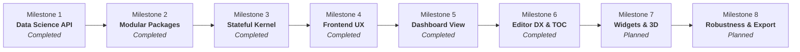

# 🗺️ BlaiseNotebook - Product Roadmap & Implementation Plan

> **Strategic Evolutionary Roadmap for BlaiseNotebook**  
> *Compiled Object Pascal (Free Pascal + Synopse mORMot 2) + Python Data Science Ecosystem (persistent HTTP daemon) + Reactive Modern Frontend (BlaiseVue 4.0)*

---

## 🎯 Vision & Objectives

Transform **BlaiseNotebook** into a premier scientific computing and interactive notebook environment for Object Pascal developers, data scientists, and engineers. The plan is organized into progressive development milestones.

---

## 📅 Milestones & Feature Breakdown

### Milestone 1: Pascal API Expansion for Data Science (`BlaiseDataScience.pas`) ✅ COMPLETED
> **Goal:** Empower Pascal programmers with complete tabular analytics, statistical visualizations, and machine learning models without writing raw Python scripts.

#### 1.1 New Native Scientific Charts (Chart.js via Pascal)
- [x] **`DF.PlotPie(Title, LabelCol, ValueCol)`**: Pie and doughnut charts with a modern palette and automatic percentages.
- [x] **`DF.PlotArea(Title, XCol, YCol)`**: Filled area chart with transparency and gradients.
- [x] **`DF.PlotHistogram(Title, Col, Bins)`**: Frequency distribution histogram with automatic bin calculation.
- [x] **`DF.PlotBoxPlot(Title, CategoryCol, ValueCol)`**: Boxplot for spread analysis and outlier detection.

#### 1.2 Fluent Data Manipulation (Pandas in Pascal)
- [x] **Expression Filtering**: `DF.Filter('RevenueK > 25.0 and Month in ["Jan", "Mar"]')`.
- [x] **Flexible Sorting**: `DF.SortBy('RevenueK', Ascending: Boolean)`.
- [x] **Dropping Columns / Nulls**: `DF.DropColumns(['ColA', 'ColB'])` and `DF.DropNA`.
- [x] **Grouping & Aggregation**: `DF.GroupBy('Category').Mean` and `DF.GroupBy('Category').Sum`.

#### 1.3 New Artificial Intelligence Models & Metrics
- [x] **`TPyLogisticRegression`**: Native binary and multiclass classification.
- [x] **`TPyDecisionTreeClassifier`**: Interpretable decision trees.
- [x] **Model Evaluation Metrics**:
  - `PyAccuracyScore(YTrue, YPred: TPySeries): Double`
  - `PyR2Score(YTrue, YPred: TPySeries): Double`
  - `PyConfusionMatrix(YTrue, YPred: TPySeries): TPyDataFrame` (renderable directly as a table).

---

### Milestone 2: Decoupled Modular Library Architecture (`frontend/server/packages/`) ✅ COMPLETED
> **Goal:** Fully decouple libraries from the native server (`server.exe`), modularizing each library (Pandas, Scikit-Learn, Math, etc.) into its own isolated folder under `packages/external/`, with dynamic auto-discovery in Free Pascal, native `uses` support in cells, and easy creation/distribution of new packages.

#### 2.1 Folder Structure & Granular Modular Separation
- [x] **`packages/core/`**: Minimal essential notebook core (`BlaiseOutput.pas`, I/O metadata, tables and charts).
- [x] **`packages/external/python_bridge/`**: Isolated communication bridge with the Python daemon (`BlaisePyKernel.pas`).
- [x] **`packages/external/pandas/`**: Official Pandas wrapper (`BlaisePandas.pas`, `requirements.txt`, `package.json`).
- [x] **`packages/external/sklearn/`**: Official Scikit-Learn wrapper (`BlaiseSklearn.pas`, `requirements.txt`, `package.json`).
- [x] **`packages/external/math/`**: Official native Pascal algebra and statistics package (`BlaiseMathKernel.pas`, `package.json`).
- [x] **`packages/external/datascience/`**: Backward-compatibility unit (`BlaiseDataScience.pas` aggregating `BlaisePandas` and `BlaiseSklearn`) ensuring no existing notebook breaks.

#### 2.2 Dynamic Auto-Discovery in `uCodeRunner.pas`
- [x] **Automatic Subfolder Discovery (`DiscoverPackageUnits`)**: Runtime scan of all subfolders in `packages/core/` and `packages/external/*`, adding paths to FPC `-Fu` without restarting the server.
- [x] **Smart Cell `uses` Parser**: Supports explicit `uses MyLib, BlaisePandas;` declarations in cells, preserving user imports and merging them with the minimal system core.
- [x] **Beginner-Friendly Compatibility Fallback**: Automatic injection of default libraries when a cell does not declare `uses`.

#### 2.3 `%pip install` Magic Command Directly in Cells
- [x] **Real-Time Execution & Streaming**: Intercepts `%pip install <package>` in `uCodeRunner` and dispatches it to the configured Python `pip`, streaming the output live to the cell console.

#### 2.4 Library Creation Documentation & Template
- [x] Documentation guide explaining how to create, package and distribute new libraries in `packages/external/`.
- [x] Ready-made starter template in `packages/external/_template/` with a Pascal Unit, `package.json`, `requirements.txt` and README.

---

### Milestone 3: Kernel Architecture & Performance (Pascal Backend) ✅ COMPLETED
> **Goal:** Deliver instant compilation, variable continuity across cells, and support for multi-output cells.

#### 3.1 Persistent Session Across Cells (Stateful Kernel)
- [x] **Shared Session Daemon**: Keeps the Python interpreter (`CPython 3.13`) and Pascal/Python variables running continuously alongside the server (`kernel/blaise_kernel_daemon.py`).
- [x] **Context Preservation**: Variables and DataFrames created in Cell 1 (e.g. `DF.SaveAs('sales_data')`) are immediately available in Cell 2 via `DF.Attach('sales_data')` without reloading.
- [x] **Session Reset**: The `Restart Kernel` command (toolbar button and WebSocket action `restart_kernel`) fully clears workspace memory and restarts the daemon state.

#### 3.2 Smart Compilation Cache (Zero-Delay Re-run)
- [x] **Cryptographic Code Hash**: Fast and precise SHA-1/SHA-256 signature in `uCodeRunner.pas`.
- [x] **Skip FPC Compilation (0ms Compilation)**: If the code is unchanged and the matching executable exists, execution is dispatched immediately without invoking the compiler (latency reduced from ~400ms to ~30ms).
- [x] **Automatic Cache Invalidation**: Automatic recompilation as soon as any character of the code changes or after a "Restart Kernel".

#### 3.3 Multiple Outputs in a Single Cell
- [x] **Payload Multiplexing**: A single execution emits multiple sequential charts and tables (`DF.ShowTable(...)`, `DF.PlotLine(...)`, `DF.PlotBar(...)`) via `@@BLAISE_PAYLOAD@@:` delimiters without overlap.
- [x] **Ordered Stacking**: Outputs are organized and stacked smoothly in the `BvOutput.bv` component, with uniform spacing and visual isolation of each card.

---

### Milestone 4: User Experience & Productivity (Frontend & UX) ✅ COMPLETED
> **Goal:** Provide a rich, professional, and accessible notebook editing experience.

#### 4.1 Autocompletion & Smart Syntax Highlighting
- [x] **Contextual Editor Suggestions**:
  - Object Pascal keywords: `begin`, `end`, `var`, `procedure`, `function`, `Format`, `Writeln`.
  - Fluent Data Science methods: `.AddColumn`, `.Column`, `.ShowTable`, `.PlotLine`, `.PlotBar`, `.ToCSV`, `.FromCSV`.
  - Trigger shortcut `Ctrl + Space` or typing the dot character (`.`).
- [x] **Enhanced Colorization**: Highlights strings, comments, keywords and scientific types (`TPyDataFrame`, `TPySeries`, `TVector`).

#### 4.2 Interactive Data Tables (DataGrid Pro)
- [x] **Column Sorting**: Click a column header to sort ascending/descending in the frontend.
- [x] **Quick Filter / Search**: Search bar to filter rows instantly in memory.
- [x] **Smart Pagination**: 10, 25, 50 or 100 rows per page with smooth navigation.
- [x] **Quick Export**: "Copy CSV" or "Download CSV" buttons directly in the generated table header.

---

### Milestone 5: Dashboard / Presentation Mode (Streamlit / Voila Style) ✅ COMPLETED
> **Goal:** Transform analytical notebooks into executive presentations and interactive dashboards with a single click.

#### 5.1 "Outputs Only" Mode (Dashboard View)
- [x] **Toolbar Toggle Button**: `📊 Dashboard View` button at the top of the screen and `Ctrl + Shift + D` shortcut.
- [x] **Code Hiding**: Hides code editors, line gutters and technical compilation indicators.
- [x] **Presentation Layout**:
  - Markdown/LaTeX text rendered as executive sections.
  - Full-width tables and charts or responsive side-by-side cards.
- [x] **Reading / Presentation Mode**: Ideal for sharing on meeting screens, executive presentations and print/PDF (`window.print()`).

---

### Milestone 6: Advanced Productivity & Editor Navigation (Frontend DX) ✅ COMPLETED
> **Goal:** Expand user productivity with intuitive notebook navigation, command history, and reusable snippet templates.

#### 6.1 Notebook-Level Action History & Undo/Redo ✅ COMPLETED
- [x] **Global Undo/Redo (`Ctrl+Z` / `Ctrl+Y`)**: Keeps a history of structural notebook actions (adding, deleting and reordering cells).
- [x] **Cell Trash (Quick Recovery)**: Restore accidentally deleted cells via the `Z` shortcut in command mode or the quick-restore banner.

#### 6.2 Cell Reordering via Drag & Drop ✅ COMPLETED
- [x] **Visual Drag Handle (`⠿`)**: Handle on the left side of each cell to drag and drop cells into the desired order.
- [x] **Visual Drop Feedback**: Animated indicator showing exactly where the cell will be dropped.

#### 6.3 Cross-Platform Portability (Windows/Linux) & Official CLI (`bvnb`) ✅ COMPLETED
- [x] **Removal of `Python4Lazarus` (`PythonEngine`) and Hardcoded Paths**: Eliminated hardcoded paths and the `Python4Lazarus` package dependency in `BlaisePyKernel.pas` and `uCodeRunner.pas`, keeping 100% of Python communication through the native HTTP JSON daemon (`TFPHttpClient`).
- [x] **Cross-Platform FPC & Python Auto-Discovery (Windows, Linux & macOS)**: Dynamic detection of `fpc` and `python3`/`python` via the system `PATH` and environment variables (`LOCALAPPDATA`, `/usr/bin`, `/usr/local/bin`), allowing anyone to clone and build without manual configuration.
- [x] **Official `bvnb` CLI — Diagnostics & Git Auto-Updater (`bin/bvnb.pas`)**:
  - `bvnb doctor`: Full tooling diagnostics (`Git`, `FPC`, `Lazarus`, `bv`, `Python 3` and individual version checks for `numpy`, `pandas` and `scikit-learn`).
  - `bvnb self-update [--check] [--channel=main|develop]`: Git-based auto-updater that syncs the official GitHub repository, recompiles `bvnb`, and rebuilds the frontend (`bv run build`) and server (`bv mormot build`).
  - `bvnb channel [use <main|develop>]`: Inspect and quickly switch between the stable (`main`) and development (`develop`) channels.
  - `bvnb build`, `bvnb run` and `bvnb setup-python`: Productivity commands to build everything, start the server and install scientific Python dependencies with a single command.
- [x] **Official Documentation Update (`README.md` and `docs/GETTING_STARTED.md`)**: Step-by-step build guide for Windows and Linux and complete `bvnb` CLI command reference.

#### 6.4 Automatic Table of Contents (Outline / TOC) ✅ COMPLETED
- [x] **Collapsible Side Panel**: Side drawer that automatically extracts Markdown headings (`#`, `##`, `###`) from the notebook.
- [x] **Smooth Scroll Navigation**: Clicking an outline item smoothly scrolls the page to the corresponding cell.

#### 6.5 Snippets & Code Recipes Catalog ✅ COMPLETED
- [x] **Quick Template Insertion Menu**: Toolbar modal to insert ready-made recipes (e.g. *Load CSV & Summary*, *Train/Test Split with Random Forest*, *Histogram + BoxPlot*).

---

### Milestone 7: Advanced Visualizations & Interactive Widgets (Data Science Pro) 📋 PLANNED
> **Goal:** Enhance data exploration with interactive visual controls, 3D representations, and automated data profiling.

#### 7.1 Inline Interactive Widgets & Filters
- [ ] **Reactive Visual Controls**: Numeric sliders, checkboxes and dropdowns insertable in cells that dynamically update execution parameters.
- [ ] **Linked Auto-Re-execution**: Moving a slider automatically recalculates the linked cell's chart or table.

#### 7.2 3D Charts & Geospatial Maps
- [ ] **3D Surfaces & Scatter**: Interactive three-dimensional rendering via WebGL (Plotly / Three.js) for multivariate data.
- [ ] **Interactive Geospatial Maps**: Visualization of geographic points (latitude/longitude), heatmaps and geographic clusters.

#### 7.3 Automatic Data Profiler for DataFrames
- [ ] **One-Click Exploratory Summary**: Button in the DataGrid Pro header showing a data quality overview: null counts, inferred types, summary statistics and distribution sparklines.

---

### Milestone 8: Kernel Robustness, Monitoring & Production Export 📋 PLANNED
> **Goal:** Deliver bulletproof execution control, real-time resource telemetry, and production-ready export targets.

#### 8.1 Safe Execution Interruption (Interrupt Kernel)
- [ ] **"Stop Execution" Button (Interrupt)**: Ability to abort a running execution (infinite loops, slow models) without killing the daemon process or losing variables in memory.

#### 8.2 Real-Time Resource Monitor (Telemetry)
- [ ] **Header Usage Indicator**: Discreet widget in the top bar showing Python daemon RAM and CPU usage and FPC compilation latency.

#### 8.3 Self-Contained Production Export
- [ ] **Standalone HTML Export**: Generate a single self-contained `.html` file with embedded Chart.js charts and tables (no server dependency for viewing).
- [ ] **Executable Script Export (`.pas` / `.py`)**: Clean concatenation of all code cells into an executable script for command-line batch automation.

#### 8.4 Multiple Kernels / Per-Workspace Isolation
- [ ] **Isolated Sessions per Tab/Workspace**: Allow different browser tabs or notebooks to run with dedicated daemon instances and ports to avoid variable collisions.

---

## 🛠️ Technical Architecture & Technologies Involved

| Component | Technology | Role |
|---|---|---|
| **Server / Kernel** | Free Pascal Compiler (FPC 3.2.2) + Synopse mORMot 2 | AOT compilation, asynchronous WebSocket server and process manager |
| **Package Manager** | Modular package system (`packages/core/` and `packages/external/`) | Library decoupling, dynamic unit and wrapper auto-discovery |
| **Data & AI Bridge** | Persistent Python daemon (HTTP JSON) + CPython 3.13 + Pandas + Scikit-Learn | Optimized Data Science and Machine Learning execution |
| **Reactive Frontend** | BlaiseVue 4.0 SPA (Pascal-to-JS transpiler) | Virtual DOM, proxy-based reactivity, Single-File Components (`.bv`) |
| **Visualization** | Chart.js 4.x + Canvas 2D / WebGL | Hardware-accelerated responsive scientific charts |
| **File Format** | `.bynb` (JSON Schema) | Full compatibility and persistence of metadata, code and outputs |

---

## 📌 Updated Execution Order

1. **Phase 1 (Scientific Foundation - COMPLETED)**: Milestone 1 (New charts, fluent methods and models in `BlaiseDataScience.pas`).
2. **Phase 2 (Modular Architecture - COMPLETED)**: Milestone 2 (Decoupling into `packages/core/` and `packages/external/`, modularization of Pandas, Sklearn, Math, dynamic `uses` support and `%pip`).
3. **Phase 3 (Speed & Continuity - COMPLETED)**: Milestone 3 (Compilation cache, multiple outputs and persistent session).
4. **Phase 4 (Advanced Interface - COMPLETED)**: Milestone 4 (Pascal autocompletion and DataGrid Pro with pagination/sorting).
5. **Phase 5 (Final Presentation - COMPLETED)**: Milestone 5 (Executive Dashboard View).
6. **Phase 6 (Productivity, Portability & `bvnb` CLI - COMPLETED)**: Milestone 6 (Global Undo/Redo, cell Drag & Drop, Windows/Linux portability + `bvnb` Auto-Updater CLI, Outline/TOC and snippets catalog).
7. **Phase 7 (Widgets & 3D - PLANNED)**: Milestone 7 (Inline interactive widgets, 3D charts/maps and Data Profiler).
8. **Phase 8 (Robustness & Production - PLANNED)**: Milestone 8 (Execution interrupt, resource telemetry and standalone HTML/script export).

---

*Document generated and maintained by the BlaiseNotebook engineering team.*
