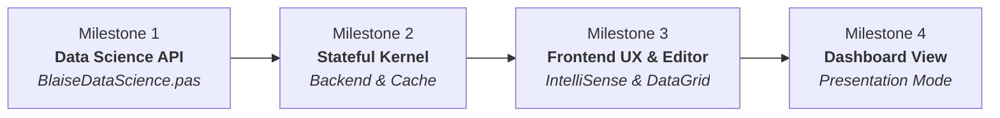

# 🗺️ BlaiseNotebook - Product Roadmap & Implementation Plan

> **Strategic Evolutionary Roadmap for BlaiseNotebook**  
> *Compiled Object Pascal (Free Pascal + Synopse mORMot 2) + Python Data Science Ecosystem (Python4Delphi) + Reactive Modern Frontend (BlaiseVue 4.0)*

---

## 🎯 Vision & Objectives

Transform **BlaiseNotebook** into a premier scientific computing and interactive notebook environment for Object Pascal developers, data scientists, and engineers. The plan is organized into **4 core development milestones** approved for implementation.

---

## 📅 Milestones & Feature Breakdown

### Milestone 1: Expansão da API Pascal para Data Science (`BlaiseDataScience.pas`)
> **Goal:** Empower Pascal programmers with complete tabular analytics, statistical visualizations, and machine learning models without writing raw Python scripts.

#### 1.1 Novos Gráficos Científicos Nativos (Chart.js via Pascal)
- [ ] **`DF.PlotPie(Title, LabelCol, ValueCol)`**: Gráficos de pizza e rosca com paleta moderna e porcentagens automáticas.
- [ ] **`DF.PlotArea(Title, XCol, YCol)`**: Gráfico de área preenchida com transparência e gradientes.
- [ ] **`DF.PlotHistogram(Title, Col, Bins)`**: Histograma de distribuição de frequências com cálculo automático de compartimentos (bins).
- [ ] **`DF.PlotBoxPlot(Title, CategoryCol, ValueCol)`**: Boxplot para análise de dispersão e detecção de outliers.

#### 1.2 Manipulação Fluente de Dados (Pandas em Pascal)
- [ ] **Filtragem de Expressão**: `DF.Filter('RevenueK > 25.0 and Month in ["Jan", "Mar"]')`.
- [ ] **Ordenação Flexível**: `DF.SortBy('RevenueK', Ascending: Boolean)`.
- [ ] **Eliminação de Colunas / Nulos**: `DF.DropColumns(['ColA', 'ColB'])` e `DF.DropNA`.
- [ ] **Agrupamento e Agregação**: `DF.GroupBy('Category').Mean` e `DF.GroupBy('Category').Sum`.

#### 1.3 Novos Modelos de Inteligência Artificial & Métricas
- [ ] **`TPyLogisticRegression`**: Classificação binária e multiclasse nativa.
- [ ] **`TPyDecisionTreeClassifier`**: Árvores de decisão interpretáveis.
- [ ] **Métricas de Avaliação de Modelos**:
  - `PyAccuracyScore(YTrue, YPred: TPySeries): Double`
  - `PyR2Score(YTrue, YPred: TPySeries): Double`
  - `PyConfusionMatrix(YTrue, YPred: TPySeries): TPyDataFrame` (renderizável diretamente como tabela).

---

### Milestone 2: Arquitetura do Kernel e Desempenho (Backend Pascal)
> **Goal:** Deliver instant compilation, variable continuity across cells, and support for multi-output cells.

#### 2.1 Sessão Persistente entre Células (Stateful Kernel)
- [ ] **Shared Session Daemon**: Manter o interpretador Python (`CPython 3.13`) e variáveis Pascal/Python em execução contínua no processo do servidor.
- [ ] **Preservação de Contexto**: Variáveis geradas na Célula 1 (ex: `DF := TPyDataFrame.FromCSV(...)`) ficam imediatamente disponíveis na Célula 2 sem necessidade de recarregamento.
- [ ] **Reset de Sessão**: Comando `Restart Kernel` limpa completamente a memória do workspace.

#### 2.2 Cache Inteligente de Compilação (Zero-Delay Re-run)
- [ ] **Hash de Código SHA-256**: Gerar assinatura única do código-fonte da célula.
- [ ] **Pular Compilação FPC**: Se a célula não foi alterada e o binário correspondente existe, despachar diretamente a execução sem passar pelo compilador.
- [ ] **Invalidação Automática de Cache**: Recompilar apenas quando houver alteração de texto ou mudança nos módulos importados.

#### 2.3 Múltiplas Saídas em uma Única Célula
- [ ] **Multiplexação de Payloads**: Permitir que uma única execução emita múltiplos gráficos e tabelas sequenciais (ex: `DF.ShowTable(...)` seguido de `DF.PlotLine(...)` e `DF.PlotBar(...)`).
- [ ] **Stacking Ordenado**: As saídas são empilhadas de forma organizada abaixo da célula correspondente.

---

### Milestone 3: Experiência de Uso e Produtividade (Frontend & UX)
> **Goal:** Provide a rich, professional, and accessible notebook editing experience.

#### 3.1 Autocompletion & Destaque de Sintaxe Inteligente
- [ ] **Sugestões Contextuais no Editor**:
  - Palavras-chave Object Pascal: `begin`, `end`, `var`, `procedure`, `function`, `Format`, `Writeln`.
  - Métodos fluentes de Data Science: `.AddColumn`, `.Column`, `.ShowTable`, `.PlotLine`, `.PlotBar`, `.ToCSV`, `.FromCSV`.
  - Atalho de gatilho `Ctrl + Space` ou digitação do caractere ponto (`.`).
- [ ] **Colorização Aprimorada**: Destacar strings, comentários, palavras-chave e tipos científicos (`TPyDataFrame`, `TPySeries`, `TVector`).

#### 3.2 Tabelas de Dados Interativas (DataGrid Pro)
- [ ] **Ordenação de Colunas**: Clique no cabeçalho da coluna para ordenar ascendente/descendente no frontend.
- [ ] **Filtro / Busca Rápida**: Barra de pesquisa para filtrar linhas instantaneamente em memória.
- [ ] **Paginação Inteligente**: Paginação de 10, 25, 50 ou 100 linhas por página com navegação fluida.
- [ ] **Exportação Rápida**: Botão "Copiar CSV" ou "Download CSV" direto no cabeçalho da tabela gerada.

---

### Milestone 4: Modo Dashboard / Apresentação (Estilo Streamlit / Voila)
> **Goal:** Transform analytical notebooks into executive presentations and interactive dashboards with a single click.

#### 4.1 Modo "Apenas Saídas" (Dashboard View)
- [ ] **Toggle Button na Toolbar**: Botão `📊 Dashboard View` no topo da tela.
- [ ] **Ocultação de Código**: Esconder editores de código, gutters de linha e indicadores técnicos de compilação.
- [ ] **Layout de Apresentação**:
  - Textos em Markdown/LaTeX renderizados como seções executivas.
  - Tabelas e gráficos em largura total ou cards responsivos lado a lado.
- [ ] **Modo Leitura / Apresentação**: Ideal para compartilhamento em telas de reunião e demonstrações para stakeholders.

---

## 🛠️ Arquitetura Técnica & Tecnologias Envolvidas

| Componente | Tecnologia | Papel |
|---|---|---|
| **Servidor / Kernel** | Free Pascal Compiler (FPC 3.2.2) + Synopse mORMot 2 | Compilação AOT, servidor WebSocket assíncrono e gerenciador de processos |
| **Ponte de Dados & AI** | Python4Delphi / CPython 3.13 + Pandas + Scikit-Learn | Execução otimizada de Data Science e Machine Learning |
| **Frontend Reativo** | BlaiseVue 4.0 SPA (Transpilador Pascal-to-JS) | Virtual DOM, reatividade por proxy, componentes Single-File (`.bv`) |
| **Visualização** | Chart.js 4.x + Canvas 2D | Gráficos científicos responsivos acelerados por hardware |
| **Formato de Arquivo** | `.bynb` (JSON Schema) | Compatibilidade e persistência completa de metadados, código e saídas |

---

## 📌 Ordem de Execução Recomendada

1. **Fase 1 (Base Científica)**: Milestone 1 (Novos gráficos, métodos fluentes e modelos no `BlaiseDataScience.pas`).
2. **Fase 2 (Velocidade e Continuidade)**: Milestone 2 (Cache de compilação, múltiplas saídas e sessão persistente).
3. **Fase 3 (Interface Avançada)**: Milestone 3 (Autocompletion de Pascal e DataGrid Pro com paginação/ordenação).
4. **Fase 4 (Apresentação Final)**: Milestone 4 (Dashboard View executivo).

---

*Documento gerado e mantido pela equipe de engenharia do BlaiseNotebook.*
