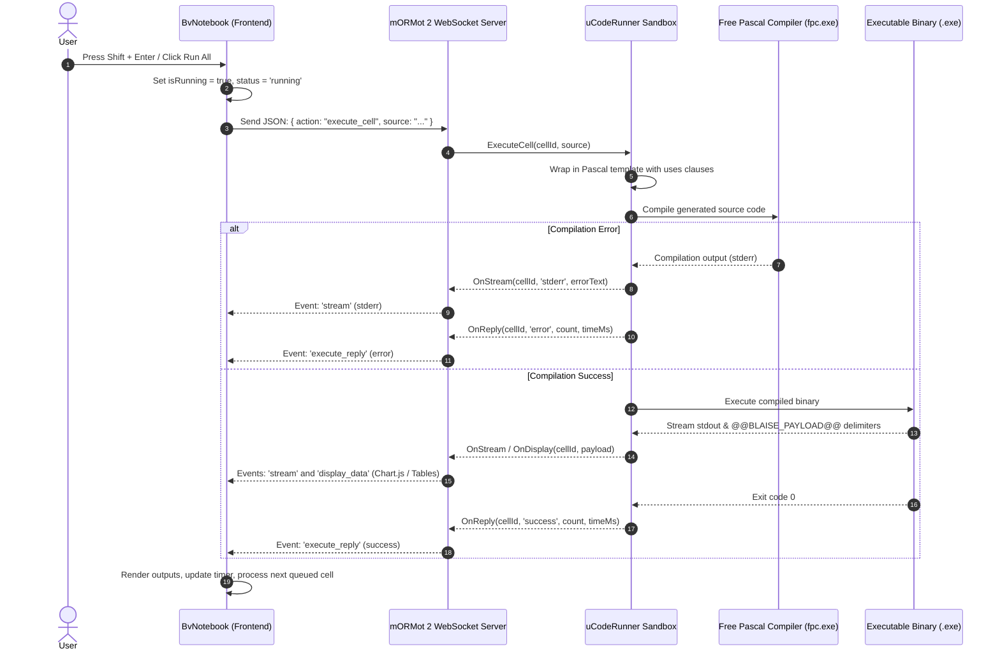

# 🏛️ Architecture & System Internals

This document details the architectural design, component interactions, and execution lifecycle of **BlaiseNotebook**.

---

## 🏗️ System Overview

BlaiseNotebook operates as a distributed computational environment comprising two primary tiers:
1. **Reactive Frontend Client:** A Single-Page Application (SPA) written in BlaiseVue and transpiled via `pas2js` into optimized JavaScript.
2. **Native Execution Backend:** A high-throughput, asynchronous native executable built with **Synopse mORMot 2** and **Free Pascal (FPC)**.



---

## 🎨 Frontend Component Hierarchy

The frontend follows BlaiseVue's Single File Component (`.bv`) architecture:

```text
frontend/src/
├── app.bv                     # Root Shell, Navbar, Theme Switcher & Drawer
├── components/
│   ├── BvNotebook.bv          # Central Workspace, Execution Queue & WebSocket Client
│   ├── BvCell.bv              # Individual Cell Card (Code / Markdown polymorphism)
│   ├── BvCodeEditor.bv        # Pascal Code Editor with Gutter & Indentation
│   ├── BvMarkdown.bv          # Markdown Documenter with Math & Live Inline Editor
│   └── BvOutput.bv            # Multi-format Output (stdout, stderr, table, <bv-chart>)
└── views/
    └── NotebookView.bv        # View Component hosting the Notebook canvas
```

### 1. `app.bv`
- Houses the top application bar (`navbar`), Project Menu drawer (`bv-drawer`), theme toggle (`☀️`/`🌙`), and the main workspace mount.
- Dispatches window-level custom events (`blaise:new-project`, `blaise:save-project`, `blaise:run-all`, `blaise:interrupt-all`) to communicate with the active notebook instance.

### 2. `BvNotebook.bv`
- **Reactive State:** Manages `cells: JSValue`, `isRunning: boolean`, `kernelStatus: string` (`'connected'`, `'busy'`, `'disconnected'`), and `executionCounter: integer`.
- **Sequential Execution Queue (`_runQueue`):** When "Run All" is clicked, cells are queued and executed one after another. `runNextQueuedCell()` is triggered upon receiving `execute_reply` for the prior cell.
- **WebSocket Protocol Client:** Connects to `ws://localhost:8090/ws`, handles reconnects, and streams cell events into component state.
- **Simulator Mode:** If the native backend is offline, an internal simulator evaluates statistical patterns and renders mock Chart.js graphs and descriptive tables seamlessly.

### 3. `BvCell.bv`
- Encapsulates execution state: `idle`, `running`, `success`, `error`, `aborted`.
- Provides execution indicator gutter badges (`In [ 1 ]: ✓`, `⏳`, `In [ ! ]: ✗`, `In [ ⏹ ]:`).
- Displays execution duration badge (`⚡ 45 ms`).
- Supports moving cells up/down, duplicating, deleting, and changing cell type between Code and Markdown.

### 4. `BvCodeEditor.bv`
- Monospace editor with line gutter numbers.
- Intercepts `Tab` to insert 2 spaces instead of losing focus.
- Listens for `Shift + Enter` (execute) and `Ctrl + Enter` (execute in-place).

### 5. `BvMarkdown.bv`
- Fast client-side Markdown parser supporting `#`, `##`, `###`, blockquotes (`>`), bullet lists (`-`), bold/italic (`**`, `*`), code blocks (```` ````), and KaTeX-style math delimiters (`$$...$$`, `$...$`).
- Double-click toggles inline editor mode; `Ctrl + Enter` commits and renders HTML.

### 6. `BvOutput.bv`
- Renders four distinct output formats:
  - **`stdout`:** Terminal console styled with macOS-like indicator dots and monospace typography.
  - **`stderr`:** Highlighted crimson container for FPC syntax errors and runtime exceptions.
  - **`table`:** Responsive, scrollable data table supporting NumPy arrays and Pandas DataFrames.
  - **`chart`:** Interactive hardware-accelerated canvas chart via `<bv-chart>` powered by Chart.js (Line, Bar, Scatter, Radar, Pie, Doughnut).

---

## ⚙️ Backend Server & Execution Sandbox

The server tier is located in `frontend/server/` and compiled natively into `frontend/server/bin/server.exe`.

### 1. Synopse mORMot 2 Native Server (`ServerApp.pas`)
- Uses `THttpServer` and `TWebSocketServer` to bind to port `8090`.
- Serves static compiled files from `frontend/dist/` with automated single-page application fallback.
- Registers the `/ws` protocol handler (`TNotebookWebSocketProtocol`).

### 2. WebSocket Protocol Handler (`NotebookKernel.pas`)
- Implements `TWebSocketProcess` callbacks (`OnIncoming`, `OnConnected`, `OnDisconnected`).
- Serializes and deserializes JSON messages with fast, allocation-free `TDocVariantData`.

### 3. Dynamic Sandboxing Harness (`uCodeRunner.pas`)
When a cell is executed:
1. **Source Generation:** Wraps the cell code into a self-contained Pascal program:
   ```pascal
   program CellExecution;
   {$mode objfpc}{$H+}
   uses SysUtils, Math, Classes, BlaiseOutput, BlaiseMathKernel, BlaisePyKernel;
   
   // Cell source code is inserted here
   ```
2. **Compilation via FPC:**
   - Invokes `fpc.exe` in a separate process (`TProcess`).
   - Includes search paths for `scientific/` units (`BlaiseOutput.pas`, `BlaiseMathKernel.pas`, `BlaisePyKernel.pas`) and `Python4Lazarus`.
   - Captures compilation diagnostics in real time.
3. **Execution & Stream Demultiplexing:**
   - Runs the produced binary in the sandbox.
   - Monitors `stdout` line by line.
   - Detects special magic delimiters (`@@BLAISE_PAYLOAD@@:`):
     - Plain lines are forwarded as `stream` events (`stdout`).
     - Delimited lines are parsed as JSON objects and forwarded as `display_data` events.
4. **Interruption:**
   - Calling `FRunner.Interrupt` terminates active subprocesses using OS-level process termination (`TerminateProcess` on Windows / `kill -9` on POSIX).

---

## 📡 WebSocket Protocol Reference

All communication over `ws://localhost:8090/ws` uses JSON envelopes:

### Client -> Server

#### `execute_cell`
```json
{
  "action": "execute_cell",
  "cell_id": "cell_abc123",
  "execution_count": 1,
  "source": "begin Writeln('Hello'); end."
}
```

#### `interrupt_cell`
```json
{
  "action": "interrupt_cell",
  "cell_id": "cell_abc123"
}
```

#### `interrupt_all`
```json
{
  "action": "interrupt_all"
}
```

### Server -> Client

#### `stream`
```json
{
  "event": "stream",
  "cell_id": "cell_abc123",
  "stream_type": "stdout",
  "text": "Computed result: 42\n"
}
```

#### `display_data`
```json
{
  "event": "display_data",
  "cell_id": "cell_abc123",
  "payload": {
    "type": "chart",
    "title": "Model Loss Curve",
    "chartType": "line",
    "data": { "labels": ["1", "2"], "datasets": [...] }
  }
}
```

#### `execute_reply`
```json
{
  "event": "execute_reply",
  "cell_id": "cell_abc123",
  "status": "success",
  "execution_count": 1,
  "execution_time_ms": 32
}
```

#### `interrupt_reply`
```json
{
  "event": "interrupt_reply",
  "status": "interrupted"
}
```
