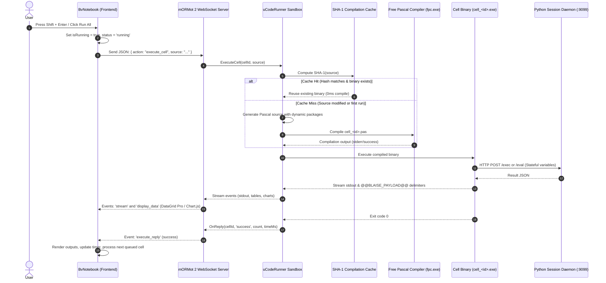

# 🏛️ Architecture & System Internals

This document details the architectural design, component interactions, and execution lifecycle of **BlaiseNotebook**.

---

## 🏗️ System Overview

BlaiseNotebook operates as a distributed computational environment comprising two primary tiers:
1. **Reactive Frontend Client:** A Single-Page Application (SPA) written in BlaiseVue and transpiled via `pas2js` into optimized JavaScript.
2. **Native Execution Backend:** A high-throughput, asynchronous native executable built with **Synopse mORMot 2**, **Free Pascal (FPC)**, and a **Persistent Python Daemon** (`CPython 3.13`).



---

## 🎨 Frontend Component Hierarchy

The frontend follows BlaiseVue's Single File Component (`.bv`) architecture:

```text
frontend/src/
├── app.bv                     # Root Shell, Navbar, Theme Switcher & Drawer
├── components/
│   ├── BvNotebook.bv          # Central Workspace, Execution Queue & Dashboard View Orchestrator
│   ├── BvCell.bv              # Individual Cell Card (Code / Markdown polymorphism)
│   ├── BvCodeEditor.bv        # Dual-Layer Syntax Highlighter & Intelligent Autocomplete
│   ├── BvMarkdown.bv          # Markdown Documenter with Math & Live Inline Editor
│   └── BvOutput.bv            # Multi-Output Stacking, DataGrid Pro & Reactive <bv-chart>
└── views/
    └── NotebookView.bv        # View Component hosting the Notebook canvas
```

### 1. `app.bv`
- Houses the top application bar (`navbar`), Project Menu drawer (`bv-drawer`), theme toggle (`☀️`/`🌙`), and the main workspace mount.
- Dispatches window-level custom events (`blaise:new-project`, `blaise:save-project`, `blaise:run-all`, `blaise:interrupt-all`) to communicate with the active notebook instance.

### 2. `BvNotebook.bv`
- **Reactive State:** Manages `cells: JSValue`, `isRunning: boolean`, `isDashboardMode: boolean`, `kernelStatus: string` (`'connected'`, `'busy'`, `'disconnected'`), and `executionCounter: integer`.
- **Dashboard Presentation Mode:** Toggling `isDashboardMode` applies the `.is-dashboard-mode` class, expanding the canvas, hiding technical code editors and gutters, and presenting clean Markdown reports with prominent DataGrid Pro tables and charts.
- **Sequential Execution Queue (`_runQueue`):** When "Run All" is clicked, cells are queued and executed one after another. `runNextQueuedCell()` is triggered upon receiving `execute_reply` for the prior cell.
- **WebSocket Protocol Client:** Connects to `ws://localhost:8090/ws`, handles reconnects, and streams cell events into component state.

### 3. `BvCell.bv`
- Encapsulates execution state: `idle`, `running`, `success`, `error`, `aborted`.
- Emits execution classes: `cell-is-code`, `cell-is-md`, `cell-has-outputs`, `cell-no-outputs`.
- Provides execution indicator gutter badges (`In [ 1 ]: ✓`, `⏳`, `In [ ! ]: ✗`, `In [ ⏹ ]:`).
- Displays execution duration badge (`⚡ 32 ms`).

### 4. `BvCodeEditor.bv`
- **Dual-Layer Real-Time Highlighting:** Background `<pre class="bv-highlight-layer">` synchronized with an editable transparent `<textarea class="bv-code-textarea">`.
- **Full Pascal Tokenizer:** Highlights comments (`//`, `{}`, `(**)`), strings (`'...'`), numbers, Pascal keywords (`begin`, `end`, `procedure`, `function`), scientific types (`TPyDataFrame`, `TPySeries`, `TVector`), and operators (`:=`, `<=`, `>=`).
- **Contextual Autocomplete Popup:** Opens on `.` (filtering fluent methods) or `Ctrl + Space` (full catalog). Supports arrow key navigation, `Enter`/`Tab` completion, and cursor positioning (`$0`).

### 5. `BvMarkdown.bv`
- Client-side Markdown parser supporting `#`, `##`, `###`, blockquotes (`>`), bullet lists (`-`), bold/italic (`**`, `*`), code blocks (```` ````), and KaTeX-style math delimiters (`$$...$$`, `$...$`).
- Double-click toggles inline editor mode; `Ctrl + Enter` commits and renders HTML. In Dashboard View, displays seamlessly as executive report sections without borders.

### 6. `BvOutput.bv`
- **Multi-Output Multiplexing & Stacking:** Sequentially stacks multiple outputs (stdout, tables, and multiple Chart.js cards) from a single cell run without overlapping.
- **Interactive DataGrid Pro (`out.type === 'table'`):**
  - Numeric and alphabetical column sorting (`▲`, `▼`, `⇅`).
  - Fast in-memory multi-column live search (`🔍 Search...`).
  - Pagination controls (10, 25, 50, 100 rows per page with `⏮`, `◀`, `▶`, `⏭`).
  - One-click RFC 4180 CSV export ("📋 Copy CSV" to clipboard and "💾 Download CSV").
- **Reactive Visualization (`out.type === 'chart'`):** Interactive hardware-accelerated canvas charts via `<bv-chart>` powered by Chart.js (Line, Bar, Scatter, Pie).

---

## ⚙️ Backend Server & Execution Sandbox

The server tier is located in `frontend/server/` and compiled natively into `frontend/server/bin/server.exe`.

### 1. Synopse mORMot 2 Native Server (`ServerApp.pas`)
- Uses `THttpServer` and `TWebSocketServer` to bind to port `8090`.
- Serves static compiled files from `frontend/dist/` with automated single-page application fallback.
- Registers the `/ws` protocol handler (`TNotebookWebSocketProtocol`).

### 2. Stateful Python Session Daemon (`kernel/blaise_kernel_daemon.py`)
- Persistent Python 3.13 process running on `http://127.0.0.1:9099`.
- Maintains the global namespace and live memory for Pandas DataFrames, Series, and Scikit-Learn models across sequential cell runs.
- Automatically started on server launch and reset upon a `restart_kernel` WebSocket request.

### 3. Zero-Delay Compilation Cache (`uCodeRunner.pas`)
- Uses native Free Pascal SHA-1 cryptographic hashing to fingerprint cell source code.
- If the source hash matches and the compiled `cell_<id>.exe` binary exists, compilation is skipped entirely (0ms overhead), reducing execution latency from ~400ms to ~30ms (12x speedup).
- Invalidation triggers automatically upon any source code change or kernel restart.

### 4. Dynamic Package Discovery (`packages/`)
- Scans `packages/core/` and `packages/external/` for Pascal units and Python requirements.
- Automatically injects `-Fu` unit search paths into the compiler command line.
- Automatically handles `%pip install` magic commands inside code cells.

---

## 📡 WebSocket Protocol Reference

All communication over `ws://localhost:8090/ws` uses JSON envelopes:

### Client -> Server

#### `execute_cell`
```json
{
  "action": "execute_cell",
  "cell_id": "cell_abc123",
  "execution_count": 1,
  "source": "uses BlaiseDataScience;\nvar DF: TPyDataFrame;\nbegin\n  DF := TPyDataFrame.Create('vendas');\n  DF.ShowTable('Vendas', 10);\nend."
}
```

#### `restart_kernel`
```json
{
  "action": "restart_kernel"
}
```

#### `interrupt_cell`
```json
{
  "action": "interrupt_cell",
  "cell_id": "cell_abc123"
}
```

#### `interrupt_all`
```json
{
  "action": "interrupt_all"
}
```

### Server -> Client

#### `stream`
```json
{
  "event": "stream",
  "cell_id": "cell_abc123",
  "stream_type": "stdout",
  "text": "Compiled in 0 ms (Cache hit). Running...\n"
}
```

#### `display_data`
```json
{
  "event": "display_data",
  "cell_id": "cell_abc123",
  "payload": {
    "type": "table",
    "title": "Vendas",
    "columns": ["Produto", "Preco"],
    "rows": [["Teclado", 250.0], ["Mouse", 85.0]]
  }
}
```

#### `execute_reply`
```json
{
  "event": "execute_reply",
  "cell_id": "cell_abc123",
  "status": "success",
  "execution_count": 1,
  "execution_time_ms": 31
}
```

#### `restart_reply`
```json
{
  "event": "restart_reply",
  "status": "restarted"
}
```
