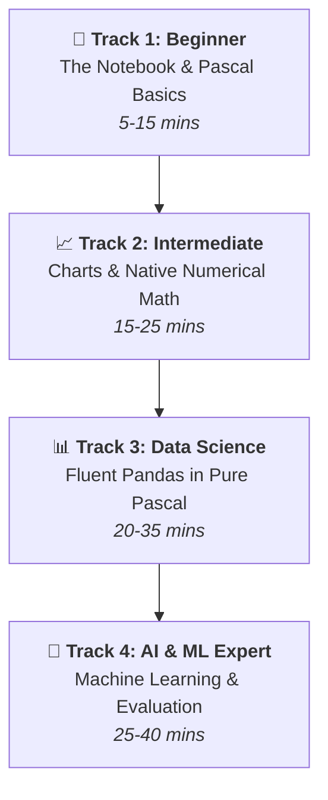

# 🎓 BlaiseNotebook Learning Tracks: From Zero to Data Science Hero

> **The complete, friendly, and ultra-easy step-by-step course for BlaiseNotebook**  
> *No prior experience with Jupyter or Python required. Write pure, elegant Object Pascal and unleash modern data science, interactive visualizations, and AI models directly in your browser!*

---

## 🧭 Choose Your Learning Track

This course is split into **4 progressive learning tracks**. Each track is designed to be crystal clear, filled with fun visual examples, and zero confusing jargon.

| Track | Level | What you will build & learn | Link |
|---|---|---|---|
| **Track 1** | 🌱 Absolute Beginner | Notebook anatomy, running cells, variables, loops, calculations, shortcuts | [Go to Track 1](01_track_beginner.md) |
| **Track 2** | 📈 Intermediate | Markdown notes, LaTeX equations ($E=mc^2$), fast `TVector` math, Chart.js plots | [Go to Track 2](02_track_intermediate.md) |
| **Track 3** | 📊 Data Science Master | `TPyDataFrame`, CSV import/export, Pie/Doughnut/Histogram/BoxPlot, Filter & GroupBy | [Go to Track 3](03_track_datascience.md) |
| **Track 4** | 🤖 AI & Machine Learning | Linear Regression, Decision Trees, Logistic Regression, Accuracy, Confusion Matrix | [Go to Track 4](04_track_machine_learning.md) |

---

## ⚡ What is BlaiseNotebook? (The 1-Minute Analogy)

Think of **BlaiseNotebook** like a smart digital notebook or interactive lab book:
1. Instead of writing a giant program and compiling it all at once, you divide your thought process into small **Cells**.
2. Some cells contain **rich notes, explanations, or mathematical formulas** (Markdown cells).
3. Other cells contain **Object Pascal code** (Code cells).
4. When you click **▶ Run** (or press `Shift + Enter`), only that specific cell executes, and its output (text, data tables, or colorful graphs) appears **immediately beneath the code**!
5. Best of all: you get all the analytical power of Python's **Pandas** and **Scikit-Learn** using **100% clean, strongly-typed Pascal classes**!

---

## 🎒 Prerequisites

You don't need to be a senior software architect! All you need is:
- A computer with BlaiseNotebook running (open `http://localhost:8090` in your web browser).
- A basic desire to explore data and see immediate results on your screen.

---

## 🚀 How to Practice While Reading

Every snippet in this course can be copied and pasted directly into your BlaiseNotebook!
- Want to start from scratch? Click **➕ Code** in your notebook toolbar and paste the snippet.
- Prefer pre-made notebooks? Open any corresponding lesson file (`.bynb`) from the [`examples/`](../../examples/README.md) folder in the top toolbar: **📁 Project** -> **📂 Open Project (.bynb)**.

Let's begin! 👉 **[Start Track 1: Absolute Beginner](01_track_beginner.md)**
